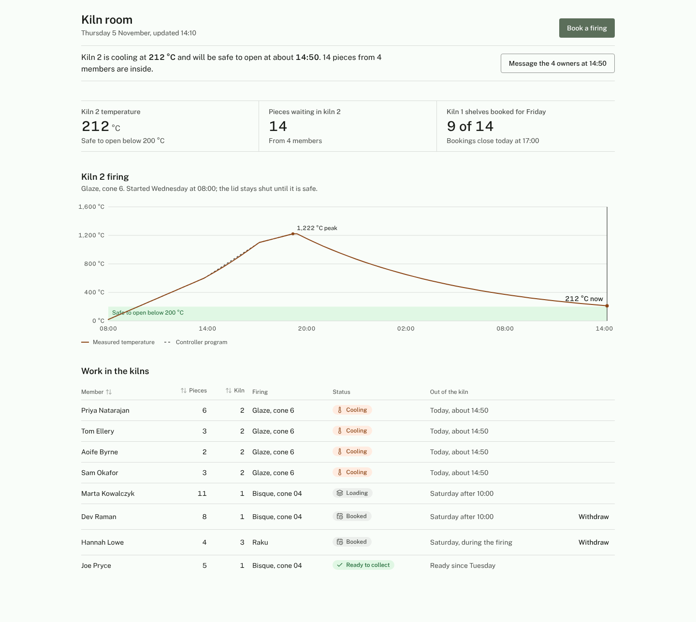

# Worked example: the kiln room at Back Lane Clay Co-op

One fictional product built end to end on Plinth, so every rule in the design docs can
be seen working. Everything here is invented for illustration: the co-op, its members
and its data. The code is real: it type-checks, compiles with Tailwind 4, renders in
Chromium in light and dark at desktop and phone widths, and passes `slop-lint` in
operate mode with no findings.

## The scenario

A 60-member pottery co-op shares three kilns. Members bring pieces to the "to fire"
shelf, book them into a firing, and want to know one thing: **is my work out of the
kiln yet?** Today (Thursday 5 November, 14:10) kiln 2 is cooling after a cone 6 glaze
firing that peaked at 1,222 °C. It is at 212 °C and will be safe to open (below
200 °C) at about 14:50, with 14 pieces from four members inside. Kiln 1 is being
loaded for Friday's bisque. One member wants to book a 38 cm vase into kiln 2, whose
shelves are 30 cm apart.

How the subject became a theme (seeds, face, signature move) is in
[`DESIGN.md`](./DESIGN.md).

## Files

| Path | What it shows | Design doc |
|---|---|---|
| [`DESIGN.md`](./DESIGN.md) | The product's token contract and reasons, with the alternates it rejected | [`../tokens.md`](../tokens.md) |
| [`AGENTS.md`](./AGENTS.md) | The rules block Plinth writes for coding agents | [`../agents.md`](../agents.md) |
| [`app/theme.generated.css`](./app/theme.generated.css) | `palette.mjs` output, unedited | [`../tokens.md`](../tokens.md) §1, §3 |
| [`app/globals.css`](./app/globals.css) | Namespace reset, status, surfaces, type, radius, elevation, motion, density, contrast, base | [`../tokens.md`](../tokens.md) |
| [`lib/utils.ts`](./lib/utils.ts), [`lib/format.ts`](./lib/format.ts) | `cn()` that knows `type-*`; all `Intl` formatting | [`../components.md`](../components.md) §1 |
| [`components/ui/`](./components/ui) | Button, IconButton, AsyncButton, Field (+ Input, Textarea, NativeSelect, ChoiceGroup), Status, Metric, DataView (+ EmptyState, Skeleton), DataTable, LineChart, PageHeader, UndoBar | [`../components.md`](../components.md) §3 |
| [`screens/kiln-room.tsx`](./screens/kiln-room.tsx) | The Operate dashboard: question, finding, figures, the signature chart, a table with undoable withdraw | [`../patterns.md`](../patterns.md) §1–§5, §7 |
| [`screens/book-firing.tsx`](./screens/book-firing.tsx) | The form: Field wiring, specific errors, focus on first error, AsyncButton, unsaved-changes warning | [`../patterns.md`](../patterns.md) §6 |
| [`screens/system.tsx`](./screens/system.tsx) | The state-matrix page: every component in every state | [`../agents.md`](../agents.md) §3 |
| [`screens/sample-data.ts`](./screens/sample-data.ts) | Sample data shaped like a real firing; totals computed, not typed | [`../patterns.md`](../patterns.md) §3 |
| [`scripts/render.mjs`](./scripts/render.mjs), [`scripts/entry.tsx`](./scripts/entry.tsx) | Build, screenshot, and the audit's mechanical render checks | [`../README.md`](../README.md) §6 |
| [`renders/`](./renders) | The screenshots below | |

## Renders

| Screen | Light | Dark | Phone |
|---|---|---|---|
| Kiln room | [1440](./renders/kiln-room-light-1440.png) | [1440](./renders/kiln-room-dark-1440.png) | [390](./renders/kiln-room-light-390.png) |
| Kiln room, loading | [1440](./renders/kiln-room-loading-light-1440.png) | | |
| Book a firing, with errors | [1440](./renders/book-errors-light-1440.png) | | [390, dark](./renders/book-errors-dark-390.png) |
| Components and states | [1280](./renders/system-light-1280.png) | [1280](./renders/system-dark-1280.png) | |



## Running the checks

```bash
cd ui-library/examples
npm install
npm run check    # tsc --noEmit · tailwindcss compile · slop-lint (operate mode)
npm run render   # build with esbuild, screenshot 8 views, fail on console errors,
                 # horizontal overflow, scrolled load, unloaded font or blank page
```

`slop-lint` over this folder also runs in the repo's test suite
(`node --test ux-design/tests/*.test.mjs`), which needs no install.

Results on 2026-11-02 (Tailwind 4.3.3, TypeScript 5, React 19, Chromium from
Playwright):

- `tsc`: no errors.
- `slop-lint --mode operate`: 20 files, 0 slop, 0 quality findings.
- Render: 8 screenshots, no console errors, no overflow, Public Sans loaded.
- Type-level guarantees, checked by adding three deliberately wrong usages and
  confirming `tsc` rejects each: `<IconButton icon={RefreshCw} />` (missing `label`),
  a `DataView` without `empty`, and `<Status tone="success" />` (missing its word).
- The namespace reset, checked by compiling a probe: `bg-indigo-500`, `bg-white`,
  `text-sm`, `rounded-xl` and `shadow-lg` produce no CSS.

What the checks found while building it, and what changed:

- A 34px horizontal overflow on the phone layout, from the chart's screen-reader table
  (`sr-only` on a `<table>` does not shrink it). The `sr-only` class moved to a wrapper.
- The y-axis stepped in 375s (0, 375, 750…), because the first "nice maximum" rounded
  the top to 1,500 and divided by four. The step is now chosen first, from 1, 2, 2.5,
  4 or 5 × 10ⁿ, giving 0, 400, 800, 1,200, 1,600.
- The peak label read 1,212 °C, not 1,222, because half-hourly readings missed the
  hold. Readings now include the controller's segment changes.
- The finding said 14:49 while the table said "about 14:50"; the computed time is now
  rounded to five minutes, since the copy says "about".
